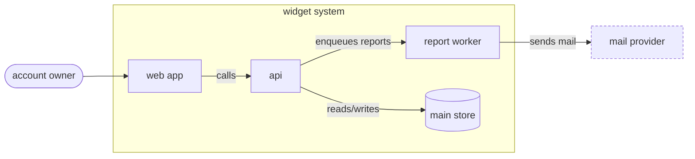

# Diagram arch

One picture of the system from the outside: who uses it, what runs, and what it talks to. Containers come from manifests and deploy config, not from folder names.

## 1. Containers

1. Run `ven-profile adapter workspace.list` (JSON) and read `ven-profile get workspaces` (name, path, kind).
2. A container runs on its own: an app, a worker, a scheduled job, a data store. Libraries and tools are not containers; fold them into the app that uses them.
3. Confirm each container in deploy config: the line that builds or starts it (container definitions, process files, deploy jobs in CI; `ven-profile detect` lists the runtime and CI files). That line is the container's citation.
4. A workspace with no deploy entry is drawn dashed and labelled `not deployed?`. Ask about it rather than guessing.

On exit 3, read the workspace manifests and deploy files yourself, per the no-adapter rule of the badge protocol in **diagram-deps**.

## 2. People and external systems

- **External systems:** outbound hosts, client setup and credential names in config and env example files. Cite the config line or the line that constructs the client. Name each one the way the repo names it.
- **People:** the user roles that reach a container, when the code makes them plain (an auth role, a separate admin app). Cite the line or leave them out.

## 3. Edges

- Container to container: cite the line that configures the client or makes the call (`ven-profile adapter code.search --var pattern=<host, queue or client name>`).
- Container to data store or external system: cite the connection or client config line.
- Label each edge with the verb that matters: "reads/writes", "enqueues reports", "sends mail".

## 4. Draw and check

The claim table that **citation-check** builds gets one row per container (its deploy line) and one per edge. Run **citation-check**; the caption counts edges, `HYBRID (n/n edges cited)`, and a container whose row fails is fixed or removed like an edge. Save it per the badge protocol as `arch-context`.

Keep it to one level. A request to zoom into one container goes to **diagram-deps** for its modules or **diagram-flow** for one request through it.
