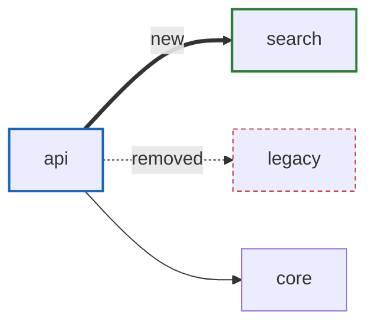

# Diagram change

Show what a diff does to the structure: which modules it touches and which dependencies it adds or removes. Both sides come from the import-graph tool, so the picture is generated, not drawn.

## 1. Range

- Default: the current branch against its base. Base is `git merge-base HEAD <default branch>`, with the default branch from `ven-profile get repo.default_branch`. Head is `HEAD`. Include uncommitted work only when asked; the head sha then carries `-dirty`.
- An empty range: say so and stop. Never diagram something nearby instead.
- Touched files: `git diff --name-only <base>...HEAD`. Group them into modules the way **diagram-deps** does.

## 2. Generate both sides

1. Head: `ven-profile adapter graph.imports` in the working tree.
2. Base: the same command at the base sha, as "At another ref" in the badge protocol of **diagram-deps** describes.
3. Collapse both outputs to module edges and compare: new = head minus base, removed = base minus head, kept = in both.
4. Keep the touched modules plus every module at the far end of a new or removed edge. Kept edges between those modules stay as plain context. Drop the rest.
5. If `graph.boundaries` is available, run it at head. A new edge that breaks a boundary is the headline.

## 3. Draw

- New edges are thick (`==>`) and labelled `new`. Removed edges are dashed (`-.->`) and labelled `removed`. Kept edges are plain.
- Touched modules are blue. Modules that appear are green, modules that disappear are red and dashed.
- Caption: `GENERATED ven-profile adapter graph.imports @ <base sha>..<head sha>`.

## 4. Report

Render it per **Rendering** in the badge protocol of **diagram-deps**. Then give three short lists:

- **New edges**, each with one import line from the diff that adds it (`path:line` at head).
- **Removed edges**, each with one import line the diff deletes (`<base sha>:path:line`).
- **Touched modules** with their added and removed line counts (`git diff --stat <base>...HEAD`).

## Without the adapter

Read the import lines the diff adds and removes (`git diff <base>...HEAD`). Each new or removed module edge cites one of those lines, so the result is HYBRID, checked with **citation-check** per the no-adapter rule of the badge protocol. Kept edges are left out, since the diff can't show them.
