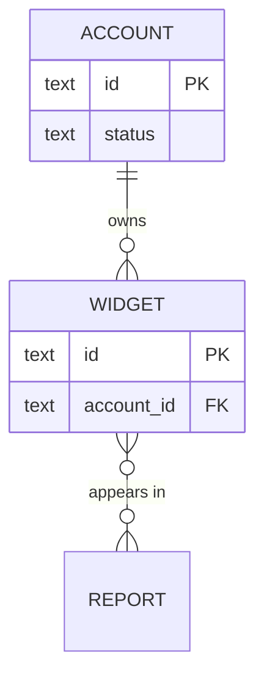

# Diagram data

Show the entities and how they relate, from the schema the repo declares. You choose the scope; the adapter supplies every entity, field and relation.

## 1. Scope

- One entity and its direct relations, a named group (one workspace's entities), or the whole model when it is small (about 15 entities).
- Show the fields that matter to the question: keys, references to other entities, state fields, and the fields being changed. Write `+n more` for the rest.
- Map domain words to entity names with `$(ven-profile path)/GLOSSARY.md`.

## 2. Generate

1. Run `ven-profile adapter schema.read`. It prints `{entities:[{name,fields,relations}]}`.
2. Keep the entities in scope plus one hop of relations. Entities outside the scope appear as stubs, name only.
3. Draw each relation with the cardinality the output gives. Never invent one: when it is missing, draw `}o--o{`, the least committal form, and say so under the diagram.

Badge it `GENERATED ven-profile adapter schema.read @ <short sha>`, per the badge protocol in **diagram-deps**.

## 3. Data diff between two refs

1. Run `schema.read` at head, then at the base ref as "At another ref" in the badge protocol describes.
2. Compare by entity name: entities added or removed, fields added, removed or changed (type, nullability, default), relations added or removed.
3. Draw only the changed entities plus their direct neighbours as stubs. Mark each change in the attribute comment (`text email "added"`, `int count "type changed: was text"`); draw removed entities with a `removed` comment on their key.
4. Under the diagram, list each change as one line. Flag the ones that need a data migration or break existing readers.

The badge carries both refs: `@ <base sha>..<head sha>`. Render it per **Rendering** in the badge protocol of **diagram-deps**.

## Without the adapter

Find where the data model is declared: schema files, migration files, model definitions (the profile's `stack` and `ven-profile detect` point at them). Each entity, field group and relation cites its declaring `file:line`, so the result is HYBRID under the protocol's no-adapter rule. When migrations are the only source, replay them in order and cite the migration that last touched each field.
