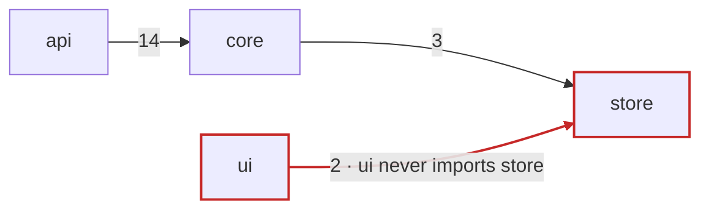
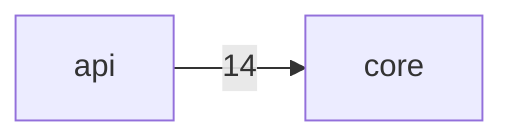

# Diagram deps

Draw who imports whom at module level, from the tool's output, never from memory. The violations are the point of the picture, so make them impossible to miss.

## 1. Scope

- The question sets the scope: the whole repo by workspace, one workspace by module, or one module and its direct neighbours. Name the scope in the caption.
- A module is a workspace (`ven-profile get workspaces`), or a top-level source directory when there is one workspace. When `ven-profile get boundaries` lists globs, use them as module names so a violation lands on whole nodes.

## 2. Generate

1. Run `ven-profile adapter graph.imports`. Its output is JSON `[{from,to}]` or Mermaid; either way it is the edge list.
2. Run `ven-profile adapter graph.boundaries` for violations `[{from,to,rule}]`. If that capability is missing but the profile lists `boundaries`, match the generated edges against them yourself and say so under the diagram.
3. Collapse file edges into module edges. Label an edge with its import count when it is above 1. Drop edges inside one module.
4. Stay readable: about 30 nodes at most. Past that, zoom out one level or split by workspace, and list what you left out.

Without `graph.imports`, follow the no-adapter rule below: one importing line per module edge is enough as its citation.

## 3. Highlight

- A violating edge is red and labelled with its rule. Both ends get the `violation` class.
- A violation already recorded under `$(ven-profile path)/baseline/` is known debt: amber, not red. Only new violations are red.
- Modules in an import cycle get a dashed outline (`classDef cycle stroke-dasharray:5 3`). A cycle is often the real finding.



## 4. Report

The diagram under its badge, rendered per **Rendering** below, then: each violation (from, to, rule, the profile's reason from `boundaries[].why`, one importing `file:line` when the output has one), each cycle, and what you left out.

## Badge protocol

Every visual skill follows this section. It is written only here.

**Badges.** A diagram's caption starts with exactly one:

- `GENERATED <command> @ <short sha>`: every node and edge came from that command's output. A diff between two refs writes `@ <base sha>..<head sha>`.
- `HYBRID (n/n edges cited)`: drawn by the model, each edge backed by a row in the claim table that **citation-check** builds and checks.
- `HYPOTHESIS`: drawn by the model and not checkable against code.

`<short sha>` is `git rev-parse --short HEAD`, with `-dirty` appended when `git status --porcelain` prints anything.

**Hybrid rule.** Put the claim table under the diagram and run **citation-check** before presenting the diagram as fact. Fix or remove every edge that fails or has no citation, or show it as a draft with those edges labelled `?` and the real count. A hybrid with an uncited edge is never saved.

**No adapter.** `ven-profile adapter <capability>` exits 3 when the capability is missing or unverified. Take the generic path: read the files yourself, cite every node and edge, and badge the result HYBRID. Name the missing capability and suggest **forge-adapter**. Exit 1 with "no profile" means the repo needs `/ven:onboard`. Any other non-zero exit: show the output tail and draw nothing from partial output.

**At another ref.** To run an adapter at a base ref, check the ref out in a throwaway worktree and run the same command there:

1. `TMP="$(mktemp -d)/base"` and `git worktree add --detach "$TMP" <base sha>`.
2. From `$TMP`: `ven-profile run commands.setup` if the adapter's `requires` needs installed dependencies, then `ven-profile adapter <capability>`.
3. `git worktree remove --force "$TMP"`. Make both outputs' paths repo-relative before comparing them.

**Saving.** Save a diagram when a later step or the user will reuse it, as `$(ven-profile path)/diagrams/<kind>-<scope>.md` (for example `deps-api`, `flow-create-widget`). Never write diagrams into the working tree.

````markdown
---
skill: diagram-deps
badge: GENERATED ven-profile adapter graph.imports @ 3f2a1bc
command: ven-profile adapter graph.imports
sha: 3f2a1bc
scope: workspace api, by module
---
# Module dependencies of api

GENERATED ven-profile adapter graph.imports @ 3f2a1bc


````

A HYBRID file's `command` lists the searches that found the edges, and its claim table follows the diagram. A HYPOTHESIS file has `command: -`.

**Rendering.** Every diagram you show gets a local page in `$(ven-profile path)/diagrams/`, even when no `.md` is saved and even when the user also asks for the Mermaid source. Read `references/diagram-page.md` before writing it: names, content, safety checks and skeleton. Offer once to publish it with the host's tool that publishes a page privately, and publish only on a yes. The reply is the badge, a short summary and the page's path, with a Mermaid fence only when the user asks for one. A request to keep it short shortens the summary, not the page.

**Reuse and drift.** Before reusing a saved diagram, compare its `sha` (the head side of a two-ref diagram) with `git rev-parse --short HEAD`. If they differ:

- GENERATED: re-run `command`, compare the edge sets, rewrite the file.
- HYBRID: re-run **citation-check** on the saved claim table, fix or drop each failing edge, rewrite the file.
- HYPOTHESIS: re-check every status before relying on it.

With no drift, render the page from the saved `.md`. Always say which it was: "no drift since <sha>" or "drifted since <sha>: <edges added, removed or failing>".
