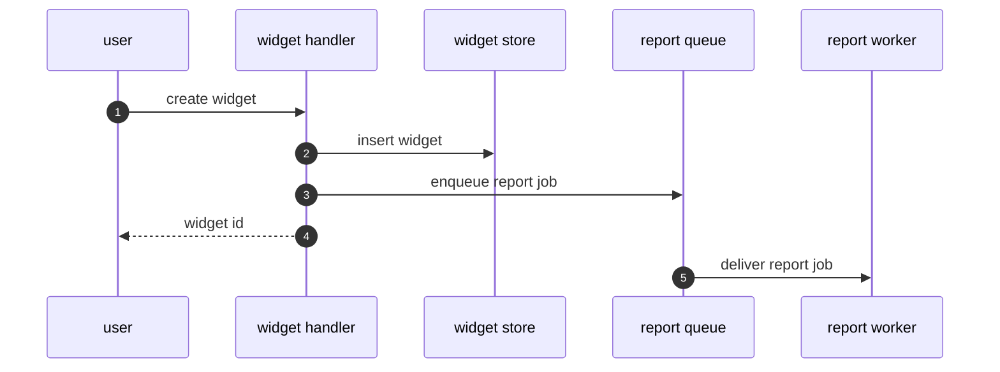

# Diagram flow

Trace one request or event from its entry point to its last effect and draw it as a sequence. You draw it; the code backs every arrow.

## 1. Pin the trigger

- One trigger per diagram: a route, a command, a message type, a scheduled job, a user action. If the request names several or none and the conversation doesn't settle it, ask which (AskUserQuestion).
- Draw the common success path. A failure path is a second diagram.
- Map domain words to code names with `$(ven-profile path)/GLOSSARY.md`.

## 2. Trace

1. Find the entry point: `ven-profile adapter code.search --var pattern=<regex>` prints `path:line:text`. On exit 3, use the built-in search tool and follow the no-adapter rule of the badge protocol in **diagram-deps**.
2. Read the entry point and follow each call that crosses a participant: a module, a process, a store, an external system. For each hop, write one claim row: what happens, and the `path:line` of the call.
3. Keep one zoom level. Participants are modules or containers, not every function. Helpers and pure functions fold into their caller.
4. An async hop (a published message, a queued job, a callback) is two arrows: sender to the queue or bus, citing the send line, then queue or bus to the handler, citing where the handler is registered.
5. Stop at the last effect: the response, the write, the emitted event. Past about 15 arrows, split into two diagrams at a natural seam.
6. What you could not trace (dynamic dispatch, routing read from config) becomes a `Note over` on the diagram, never an arrow.
7. Draw a return arrow only when it carries data the reader needs. It cites the line that returns or replies.

## 3. Draw

Number the arrows so they line up with the claim table that **citation-check** builds (`E1` is arrow 1).

| id | claim, in words | citation |
|---|---|---|
| E1 | the route sends "create widget" to the handler | `src/widgets/routes:12` |
| E2 | the handler inserts the widget | `src/widgets/handler:40` |
| E3 | the handler enqueues a report job | `src/widgets/handler:44` |
| E4 | the handler replies with the new id | `src/widgets/handler:47` |
| E5 | the worker registers as the report job's handler | `src/reports/worker:8` |

## 4. Check and badge

Run **citation-check** on the table. Fix the citation, redraw the arrow, or remove it until every row passes; then the caption is `HYBRID (n/n edges cited)`. Save and reuse it per the badge protocol in **diagram-deps**, as `flow-<trigger>`.

Under the diagram, list what you folded away and what you could not trace, so the reader knows where the picture stops.
