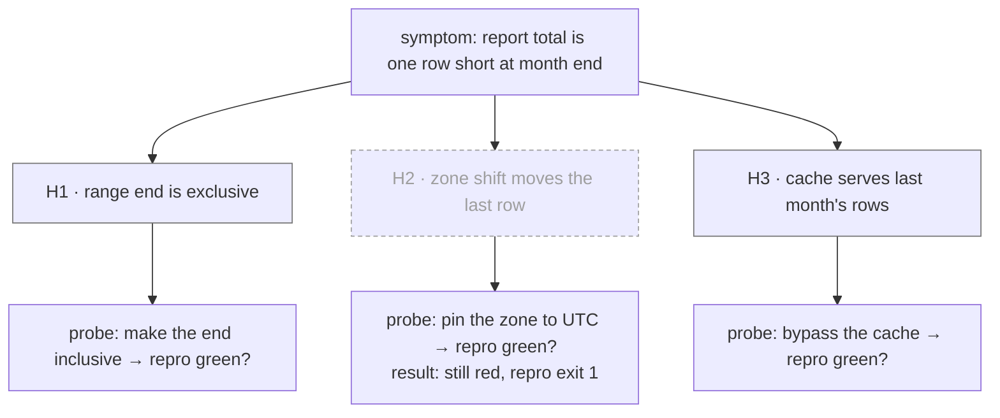

# Diagram hypotheses

A map of what might be wrong and how you will find out, drawn before you test anything. It is model-drawn by design, so its badge is always `HYPOTHESIS`. Trust comes from the evidence written into its nodes.

## Before you draw

You need the user's exact symptom and one command that goes red on it, already run. Without that command, get it first: theorizing before the bug reproduces is the failure this tree exists to prevent.

## 1. Write 3 to 5 hypotheses

- Write them all before testing any. A single hypothesis anchors on the first plausible idea.
- Each one is falsifiable. Its prediction reads: "If <cause>, then <changing Y> makes the symptom disappear" (or worse, or move). If you can't state the prediction, the hypothesis is a vibe: sharpen it or drop it.
- Rank by likelihood, then by how cheap the probe is. Prefer causes near where the bad value first appears over causes where it surfaces; apply **fix-root-causes**.

## 2. Draw the tree

Symptom, then hypotheses, then the probe that would falsify each, then its status.

- **open:** not probed yet.
- **falsified:** the probe ran and the prediction failed.
- **supported:** the symptom moved as predicted, but the cause isn't proven yet.
- **confirmed:** a change at that cause turns the repro green, and the original scenario passes too.

A probe node that has run holds its result and evidence: the command and its exit code, or a `file:line`.

## 3. Show, then probe

- Show the ranked tree to the user before probing. They often re-rank it at once ("H3's area changed yesterday") or have ruled one out. If they're away, proceed with your ranking.
- One probe, one variable. A probe that doesn't confirm is reverted before the next; never stack changes.
- Redraw the tree after every probe with the new status and its evidence. Record it: `ven-decisions add --step diagram-hypotheses --decision "H2 falsified" --evidence "<command> exit 1"`.
- Every hypothesis falsified: your model of the system is wrong. Go back to the symptom and the repro, re-read with what the probes taught you, and write a fresh set. Say "I don't understand X" rather than guessing.

## Badge and saving

The badge stays `HYPOTHESIS` even after a cause is confirmed; the confirmation lives in that node's evidence. When the investigation spans sessions, save the tree per the badge protocol in **diagram-deps** as `hypotheses-<slug>`, so a handoff note can point to it.
