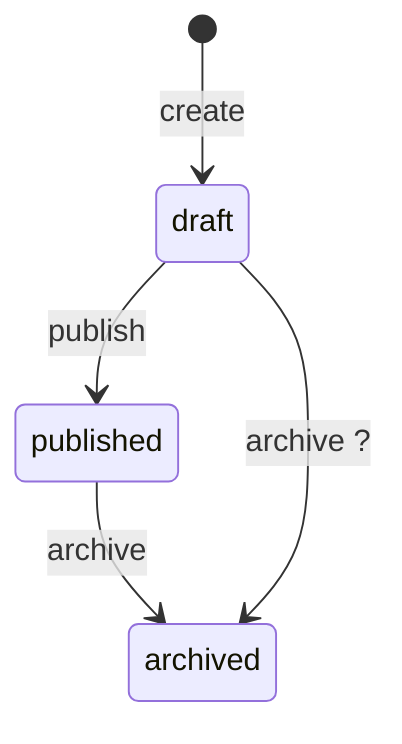

# Diagram state

States come from the code that declares them. Transitions come from the code that changes them. A transition you can't point to is inferred, and it must look inferred.

## 1. Find the states

1. Find the declaration of the entity's states: an enum, a union type, or a set of constants. Map the entity's domain name to code with `$(ven-profile path)/GLOSSARY.md`, then search with `ven-profile adapter code.search --var pattern=<type or field name>`.
2. List its members with `ven-profile adapter symbols.list --file <path>`, which prints `name kind line`. Each state cites its declaring line.
3. A state value used in code but missing from the declaration (a bare literal somewhere else) is a finding. Draw it with an `undeclared` note.

On exit 3 from either adapter, read the declaring file and search yourself, per the no-adapter rule of the badge protocol in **diagram-deps**.

## 2. Find the transitions

For each state, find every place that sets the entity's state field to it. At each site, read the guard to learn the source state.

- **Cited:** the site shows the source (a guard, a match arm, a conditional write that filters on the current state) and the target. Cite the line that writes the target.
- **Inferred:** the target is clear but the source is not (no guard, or a write that accepts any state). Draw it with a `?` after its label.
- **Initial state:** where the entity is created or its default is declared. Cite that line on the `[*]` edge.
- A write that accepts any state is one row under the diagram ("any state → archived"), not an edge from every state.

## 3. Draw and check

Put the claim table that **citation-check** builds under the diagram: one row per state declaration and per cited transition. Run **citation-check**. The caption counts transitions: `HYBRID (3/4 edges cited)` while an inferred edge is on screen.

A saved state diagram has only cited transitions. Before saving per the badge protocol (as `state-<entity>`), drop each inferred edge from the diagram and list it under "Inferred transitions, not in the diagram" with the line that made you suspect it.

## 4. Findings

After the diagram, list what the picture reveals:

- States with no incoming transition (unreachable) and states with no outgoing one that are not meant to be final.
- Undeclared states, and transitions that skip a guard the others have.
- Writes that accept any state, since they bypass the machine.

Render it per **Rendering** in the badge protocol of **diagram-deps**.
